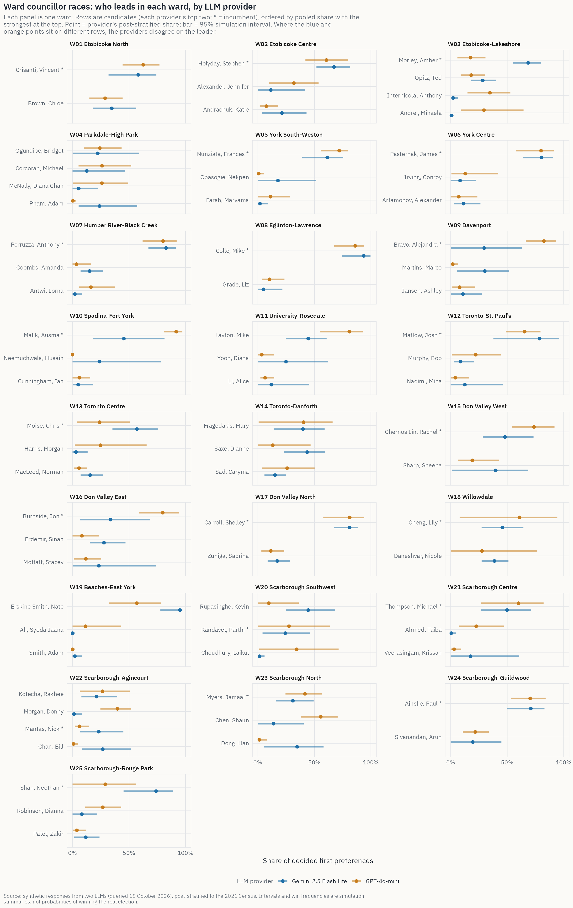
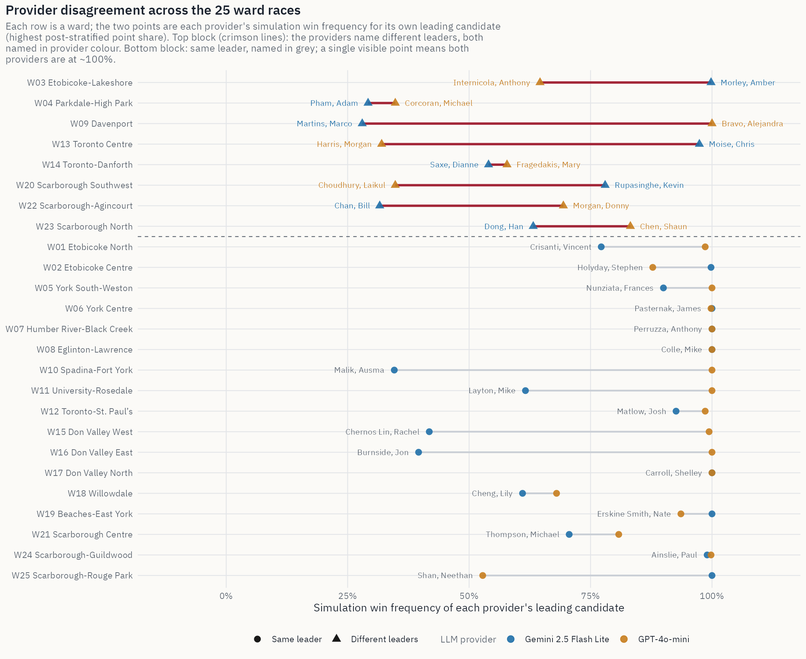
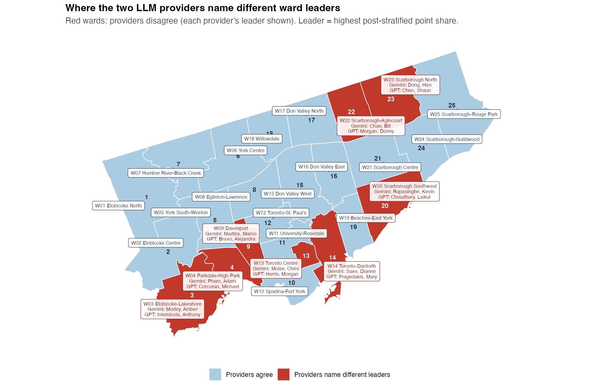

## Overview {#overview}

### Research question and objective

All the data on this page comes from synthetic voters. We use two Large Language Models (LLMs) to act as Census-based Toronto residents and answer ballot questions. No real people were surveyed.

Toronto will elect a mayor and 25 ward councillors on Monday 26 October 2026. Our forecast does not incorporate published opinion polls. Previous research has discussed the problem of forecasting with samples that do not represent actual voters [@wang2015forecasting]. In this project, we aim to investigate:

> **Can a silicon sample — simulated voters generated by large language models and post-stratified to Census marginals — produce a transparent, reproducible forecast for all 26 Toronto municipal races, and what uncertainty and model disagreement does it imply?**

Our prediction objective is to build a reproducible pipeline to estimate vote-share distributions and conditional win frequencies for each candidate in the mayoral race and all 25 ward councillor races, while also showing the uncertainty in the results.

We use silicon sampling [@argyle2023out] in this project, while also considering the challenges and limitations of using LLMs to simulate voters [@bisbee2024synthetic; @heath2026correcting].

**Pipeline:**

We use two Large Language Model (LLM) providers to collect voting intentions from 3,042 synthetic personas, and the whole process is repeated three times. Since the population of synthetic personas may be different from that of Toronto, we decided to use post-stratification to calculate vote shares for each candidate. To include uncertainty, we chose to use Method C, which combines Dirichlet sampling and multiplicative adjustment (SD = 4pp) to further simulate possible results under various situations. Finally, we report the prediction results from each provider and provide an equally weighted aggregated prediction for comparison.

**Headline Results:**

- **Mayor:** Olivia Chow received 97.7% of valid responses. However, after adding headlines, the prediction results became unstable, with Brad Bradford receiving 97–99% of valid responses on 20 October and Olivia Chow receiving 99% on 21 October. This means that the models were more affected by headlines than by the demographic profiles of the synthetic personas.
- **Wards:** Based on the vote shares after post-stratification, the two providers disagreed on the leading candidate in 8 of 25 wards.
- **Uncertainty:** When the assumed perturbation increased from 2pp to 6pp, the median leading candidate interval width rose from 33.6pp to 41.0pp.

---

## Election Forecasts {#forecasts}

### The mayoral race

{#fig-mayor fig-alt="Dot-and-interval chart of mayoral vote shares by LLM provider. Chow, Olivia (incumbent) leads at about 99.9 percent post-stratified share for Gemini and 94.7 percent for GPT-4o-mini, with all other candidates near zero. Points are post-stratified point estimates; horizontal bars are 95 percent simulation intervals."}

In the figure, dots represent the estimates after post-stratification, and horizontal bars represent 95% simulation intervals. The two providers are shown separately in different rows, and the figure shows the eight candidates with the highest pooled vote shares. Gemini shows that Olivia Chow receives 99.9% of decided first-preference votes, while GPT-4o-mini gives a result of 94.7%. Meanwhile, GPT-4o-mini has a wider simulation interval, illustrating that GPT-4o-mini has more variation compared to Gemini. In our simulation, Chow's win frequencies are 100% and 99.2% under Gemini and GPT-4o-mini, respectively. Although both providers give Chow very high win frequencies, these do not represent her actual probability of winning the election.

::: {.callout-warning}
## Mayoral mode collapse — read this before quoting any mayoral number
There is mode collapse in the production silicon sample. The prediction results fail to form a competitive distribution. The responses from both Gemini and GPT are mostly concentrated on the same candidate, Olivia Chow, who received 97.7% of all valid mayoral choices. To distinguish whether this is caused by ballot position, we conduct a diagnostic experiment. We reproduced the pipeline under three ballot orders (see [Diagnostics](#diagnostics)). Nevertheless, the same mode collapse still appeared in the experiment. The same issue has also been documented by @heath2026correcting. Besides, the [Daily Tracker](#daily) indicates instability in the outputs. When the day's headlines favour Brad Bradford, the same mode collapse shifts to him. Hence, no uncertainty method can create a competitive forecast from these results.
:::

Full mayoral detail, one row per candidate sorted by descriptive pooled share (candidates with pooled share above 0.1% or any provider share above 0.5%):



### Ward councillor races

{#fig-wards fig-alt="Faceted dot-and-interval chart for all 25 ward councillor races. Each panel lists the candidates in either provider's top two, with each provider's post-stratified point estimate as a dot and its 95 percent simulation interval as a horizontal bar."}

Each ward will correspond to a single panel, where each panel shows the candidates ranked in the top two by either model to ensure the prediction of the top 1 candidate of each model can be included (incumbents marked \*). Candidates are ordered by the descriptive pooled share from the highest to the lowest. Each dot represents a provider's point estimate and horizontal bar represents as 95% simulation interval. Therefore, if the highest dot appeared in different rows for two providers, it means that their predictions of the first ranking are disparate, such as Ward 03, 09 and 13 shown in the Figure. For each ward and provider, the effective sample sizes are small (Kish $n_{\text{eff}}$ ≈ 79–165) so that the prediction intervals are wide (typically 30–60 percentage points). This reflects the uncertainty within LLM response mechanism. Full per-candidate summaries with all 243 candidates across 26 races are stored in `processed/forecast/forecast_summary_centered.parquet`.

### All 26 races

Each race corresponds to one single row. The pooled leader is an equal-weight average of two providers instead of a combined forecast.



---

## Daily Tracker {#daily}

A scheduled GitHub Action asks the same personas to generate results every day based on that day's Toronto headlines and updates the figures and tables here.



### Mayor {#daily-mayor}

Each point is one model's share that day. The thick line is a moving average of the two models.

{#fig-daily-mayor fig-alt="Line chart of daily mayoral shares. Points are each model's estimate. The thick line is a moving average."}



Shares for the last 14 days:



### Ward councillor races {#daily-wards}

Each panel is one ward. Lines are moving-average shares for that ward's top two candidates.

{#fig-daily-wards fig-alt="Small line charts, one per ward, of moving-average shares for the top two councillor candidates."}



### Today's news context {#daily-news}

Headlines shown to the personas that morning.



### API costs {#daily-costs}

What that day's requests cost.



---

## Provider Comparison {#providers}

{#fig-disagree-a fig-alt="Dotplot with 25 rows, one per Toronto ward. Each row has two coloured dots connected by a line showing each provider's simulation win frequency for its leading candidate; the top 8 red rows are wards where providers name different leaders, each labelled with both leaders' names; the other 17 rows are labelled with the shared leader's name."}

The map below shows the same disagreement geographically: every ward is labelled with its number and name, and each red ward also lists the two providers' different leaders. Disagreement clusters in the old city core (Wards 04, 09, 13, 14), the Etobicoke lakeshore (03), and northern and southwestern Scarborough (20, 22, 23).

{#fig-disagree-b fig-alt="Map of Toronto showing all 25 ward polygons, each labelled with ward number and name; 8 wards are shaded red where providers name different leading candidates, with labels giving the Gemini and GPT leaders, and 17 are shaded light blue where they agree."}

### Reconciling two leader definitions

A leading candidate can be defined in two ways:

- **Provider point estimates:** Average the results from three repeat cells.
- **Win frequencies:** Average the results from 500 draws that resample cells and add uncertainty layers.

These two methods may identify different leading candidates in some wards.

| Leader definition | Wards where providers disagree |
|---|---|
| Highest **post-stratified point share** (used on this site) | **8**: W03, W04, W09, W13, W14, W20, W22, W23 |
| Highest **simulation win frequency** | **7**: W03, W04, W14, W15, W20, W22, W23 |

The website uses the **point-share definition** throughout (@fig-wards, @fig-disagree-a, @fig-disagree-b, @tbl-races, and this section). The three definitional edge cases are instructive:

- **Ward 09:** Based on vote-share point estimates, the two providers disagree. Gemini shows that three candidates' vote shares are close (Marco Martins (30.1%), Alejandra Bravo (29.7%), and another candidate (29.3%)), with Marco Martins slightly leading, while GPT mainly supports Alejandra Bravo (82.5%). Conversely, based on win frequencies, both providers agree that Bravo is the leading candidate.
- **Ward 13:** Based on vote-share point estimates, the two providers disagree. Gemini predicts that Chris Moise gets 57.0%, while GPT shows that Morgan Harris is leading with 24.7%, which is slightly higher than Chris Moise's 24.0% under the same provider. Conversely, based on win frequencies, both providers agree that Moise is leading.
- **Ward 15:** Based on vote-share point estimates, both providers agree that Rachel Chernos Lin is leading (48.0% from Gemini and 73.7% from GPT). Conversely, based on win frequencies, the two providers disagree. In Gemini's simulation, Sheena Sharp has a higher win frequency (58.0%) than Rachel Chernos Lin (41.8%).

Two patterns matter regardless of definition:

1. **The two providers disagree more than our uncertainty settings do.** Among several wards with different prediction results, one provider gives its leading candidate a win frequency close to 90%, while the other gives its own leading candidate only about 35%. It indicates that the difference between providers is much larger than the change from any uncertainty setting we tested (see [Forecast Uncertainty](#uncertainty)).
2. **The two providers answer from different groups of personas.** It is much more common for GPT-4o-mini to answer "undecided" compared to Gemini, especially in the mayoral election (19.4% vs. 0.8%; see [Diagnostics](#diagnostics)). Since "undecided" answers are excluded from further predictions, each provider predicts based on different synthetic personas. We will report predictions for the two providers separately, and the pooled column is only for description instead of a pooled forecast.

---

## Forecast Uncertainty {#uncertainty}

Our forecast uncertainty comes from several sources. We used a Dirichlet model to simulate the prediction sampling uncertainty, 
and we also add a 4-percentage-point standard deviation in Method C to try to capture the random changes in a real election. 
However, changes in the turnout, unexpected campaign events, or systematic biases shared by the LLMs still remain unaccounted. 
@shirani2018disentangling show that bias and variance are the two most common error generated by real election poll,
Since the election has not yet taken place, we cannot measure these biases against actual results.
Our uncertainty intervals may therefore be narrower than the true uncertainty on the election outcomes.

Below describes four sources of uncertainty, along with how we handle each of them in our simulations.


1. **LLM response variability**: when collecting responses from synthetic voters, we asked LLM three times and got different voting result (since temperature was set to 0.7). When performing forecast simulations later on, we will select random one from the three previous response.
2. **Dirichlet sampling uncertainty**: shares ~ Dirichlet($n_{\text{eff}} \cdot \hat{s} + 0.5$), where $n_{\text{eff}} = (\sum_i w_i)^2 / \sum_i w_i^2$ is the Kish effective sample size of the post-stratified cell. This approximates how much the estimated vote shares could vary because they are based on a limited, unequally weighted synthetic sample.
3. **Assumed forecast perturbation (Method C)**: a centered multiplicative perturbation $s_k \propto s_k \cdot e^{\sigma \varepsilon_k}$, $\varepsilon \sim N(0,1)$, with $\sigma$ calibrated per race so this layer alone gives the leader a standard deviation of the target standard deviation (SD), with 4pp as default. It keeps the sum of all candidates' support rate adds to one, does not change 0% supported candidates, and is preserving the mean.
4. **Real election uncertainty**: We cannot model this uncertainty since we cannot accounts for turnout swings, campaign events, polling house effects, or systematic model errors.

::: {.callout-note}
## "Win frequency" ≠ "probability of winning"
Throughout this site, **simulation win frequency** is the fraction of the candidate getting highest support rate among all 500 simulations.
It is not equal to the actual probability of that candidate wins the real 2026 election, we have no ground truth to calibrate against, and LLMs have systematic bias that cannot be corrected.
This was mentioned in @gelman2020information and @kay2016when that communicating the gap between uncertainty in simulation and uncertainty in real world is important, a 100% support rate in graph does not mean the election result is set. 
Currently 15 of 52 race × provider units show a win frequency of exactly 100%, and 18 of 52 sit at or below 70%.
:::

### Sensitivity to the assumed perturbation scale

{#fig-sens fig-alt="Two panels. Left: leader 95 percent interval widths for all 52 race-by-provider units at target SD 2, 4 and 6 percentage points, shown as thin coloured lines with points and a dark median line rising from 33.6 to 37.3 to 41.0 percentage points. Right: bar chart of the number of units with win frequency exactly 100 percent, falling from 21 to 15 to 12, with the published 4 pp setting highlighted."}

We want to know if changing the 4pp SD in Method C to 2pp or 6pp, how would it affects the prediction result. So we re-ran the forecast simulation three times, changing only the standard deviations. Panel (a) tracks each race × provider leader's 95% interval width across the three simulations, the graph shows a linear upward trend when standard deviation increased, supporting that adding more standard deviation leads to wider interval.
Panel (b) counts how many race × provider units still give their leader a 100% win frequency, as the standard deviation increased, more noise included, model become more uncertain and the number of units at 100% win kept dropping. 
Together they show that the width of our intervals and how many races look like a certain win are partly a modelling choice, not something the data pins down.

Other than the perturbation scale, adding 0.5 to Dirichlet will shrink the overall supporting rate towards uniform, causing support rate for leader to decrease. 
We saw our worst case in Ward 19, where pseudo-count takes 5.4% of the total Dirichlet parameters, and average leader support rate decreased by 4.7pp.
On the other hand, Method C can only approximately preserve the center.

---

## Silicon Sampling Diagnostics {#diagnostics}

{#fig-diag fig-alt="Three panels. (a) Bar chart of candidate-order invariance: 100 percent for the mayoral race for both providers, 56.3 percent for Gemini and 62.5 percent for GPT-4o-mini on 12 sampled ward races. (b) Bar chart of mayoral response concentration: Chow near 100 percent for Gemini, about 95 percent for GPT, with small bars for minor candidates. (c) Bar chart of provider undecided rates: GPT-4o-mini 19.4 percent mayoral and 3.9 percent ward, Gemini 0.8 and 1.0 percent."}

In the previous section, we measured how uncertain the simulation results are. Now we want to explore on whether the synthetic voter responses generated by LLMs are reliable.

**Candidate-order invariance.** We first want to understand if the sequence of candidates affect LLM's decision. 
In this diagnostic, we asked each persona-race under three ballot orders: original ballot order, and two randomized orders. 
The mayoral choice was 100% order-invariant for both LLMs, which confirms that the collapse is knowledge-driven, instead of affecting by the ballot position. 
Ward-race choices, whereas, were invariant in only 56–63% among all three ballot orders, meaning 37-44% persona-race combination changed their selection when order changed.
For example, Ward 10, using same persona, changed their voting when ballot order is different, this shows ward-level LLM responses are unstable and are meaningfully order-sensitive, which @murray2026choices also documented.
The diagnostic used the original ballot order as one of three test conditions; the production run randomized candidate order for each request.

**Mayoral response concentration.** From the result ran on first day (2026-10-17), 99.9% (Gemini) and 95.0% (GPT) voted for Chow, and the remaining mass is spread over other minor candidates.

**Provider undecided rates.** We allow synthetic voters to not select any candidate, and instead respond "undecided". 
During mayoral race, GPT-4o-mini answers "undecided" on 19.4% of the time while Gemini 2.5 Flash Lite gives 0.8%.
During ward races, GPT-4o-mini gives "undecided" 3.9% of the times and Gemini 2.5 Flash Lite is 1.0%.
We excluded undecided responses from estimation and only count those who decided the candidate they want to vote for.


To summarise, LLMs are sensitive to ordering of the candidates, they might not be able to show preferences from all voters, and different LLMs have different response rate.

Full diagnostic design and report is available at: `docs/llm_diagnostic_experiment.md` and `docs/llm_diagnostic_report.md`.

---

## Data and Methods {#methods}

### Data sources

We use official City of Toronto data to construct our synthetic voter population, identify candidates in the 2026 municipal election, and provide historical and geographic context. The main datasets and their uses are summarized below.


| Dataset | Use | Source |
|---|---|---|
| Ward Profiles, 25-ward model (2021 Census) [@to2021wardprofiles] | Population frame and post-stratification marginals (ward × age × education) | Toronto Open Data |
| Official 2026 candidate lists (mayor, councillors, withdrawn) [@to2026candidates] | Candidate roster and ballot names for all 26 races | toronto.ca elections |
| Official 2022 election results [@to2022results] | Historical sanity checks; candidate/incumbency context | Toronto Open Data |
| 2023 mayoral and Ward 20, 2024 Ward 15, 2025 Ward 25 by-election results | Updated historical context | Toronto Open Data |
| 2022 Elections Voter Statistics [@to2022turnout] | Ward-level turnout context | Toronto Open Data |
| Wards and Elected Councillors boundaries [@to2026wards] | Map geometry and ward validation | Toronto Open Data |
| Elected officials 2022–2026 | Incumbent identification (name match) | Toronto Open Data |

All datasets were downloaded using download_data.R. Their original URLs, file sizes, and SHA-256 checksums are recorded in sources.json to support reproducibility.

We use the 2021 Census Ward Profiles to build the population frame for post-stratification. Each ward is divided into four age groups and three education groups, giving us 12 demographic groups per ward and 300 across Toronto's 25 wards. We restrict the population to residents aged 20 and older.

One limitation is that the available Census tables report age and education separately, rather than their joint distribution within each ward. We therefore estimate the proportion of each age–education group by multiplying the two marginal proportions: $P(\text{Age}, \text{Education} \mid \text{Ward}) \approx P(\text{Age} \mid \text{Ward})\,P(\text{Education} \mid \text{Ward})$

This assumes that age and education are independent within each ward, which may not hold in practice. As a result, the population weights used in post-stratification are approximations rather than exact Census counts for each demographic group.

### Silicon sampling

Using 2021 Census data, we split Toronto population into 25 wards * 4 age groups * 3 education groups = 300 cells. We then generated 3,042 synthetic voter among the 300 cells based on each cell's population with age above 20.
We defined at least five personas per cell, so the final synthetic sample population may not reflect the true census population.
Therefore, we assign each persona a weight to let it be able to represent the population during post-stratification.

In the experiment, we used two LLMs through OpenRouter: Gemini 2.5 Flash Lite and GPT-4o-mini. 
For every persona in each model, they were asked three times independently, and we used a temperature of 0.7. 
With 3,042 personas, each run 2 races (mayoral and ward), two models, and three repetitions, this produced **36,504 requests**.

In each prompt, we included the persona's ward, age group, education level, and the candidates running in that race. 
The models were not given other personas' responses, Census weights, candidate biographies, policy positions, or historical election results. 
We also randomized candidate order to reduce reliance on any single ballot ordering, although our previous results showed that ward-level responses remain sensitive to candidate order.

Responses were collected on October 18, 2026, and validated against a structured JSON format. Invalid responses were retried, and successful responses were cached to avoid unnecessary API calls. The final dataset contains 36,504 responses and is saved in `processed/production/llm_responses.parquet`.

### What the model sees

Each request has a fixed system message (prompt version v1, `llm/prompts.py`) and a short user message. The system message tells the model it is simulating one Toronto resident in a municipal election survey, asks for a JSON reply of the form `{"response_status": "valid_choice" | "undecided" | "not_voting", "candidate_id": ...}`, and instructs it to base its choice only on the candidate names and the respondent's demographics. The user message for persona P000446 and the Ward 4 race reads as follows (shown in ballot order; production shuffles the list per request):

```text
Respond as the following Toronto resident:
- Ward: 4
- Age group: 30-44
- Education group: High school or less

Race: City Councillor for Ward 4 (you are a resident of Ward 4).

Candidates in this race (candidate_id: name):
- W04-C01: Corcoran, Michael
- W04-C02: Guerrera, Nadia
- W04-C03: King, Debbie
- W04-C04: McNally, Diana Chan
- W04-C05: Ogundipe, Bridget
- W04-C06: Pham, Adam
- W04-C07: Potega, Andy
- W04-C08: Raponi, Vanessa
- W04-C09: Weber, Holly
- W04-C10: Yuen, Steve

Return only the JSON object.
```

The daily tracker (prompt v2) adds the date, the election date, and up to 12 of that day's Toronto headlines to the system message.

### Post-stratification

To adjust synthetic responses to the real population, inspired by @wang2015forecasting and @little1993post, we used post-stratification to weight each persona according to the population share for each ward they based on. 
For each race, LLM provider, and repeat, we estimate candidate vote share to be weighted proportion of the decided responses.
$$\hat{s}_k \;=\; \frac{\sum_i w_i \,\mathbf{1}[\text{choice}_i = k]}{\sum_i w_i}$$

Undecided and not-voting replies are excluded from both numerator and denominator since we want the candidate share among decided synthetic responses only,
it is not turnout, nor the voting rate for entire population. 

For ward races, we sum over that ward's personas only, while the mayoral race sums over all personas with citywide weights.

Since we repeated three times per persona, we take their average as the point estimates. 
A descriptive pooled estimate is averages the response from all repetitions and LLM providers, we used it as a simple summary for readers, and it's never used as "the" forecast.

### Software {#software}

The language models are GPT-4o mini [@gpt4omini] and Gemini 2.5 Flash-Lite [@geminiflashlite], both reached through OpenRouter [@openrouter]. The query pipeline is written in Python [@python] with requests [@requests] and PyArrow [@pyarrow], and tested with pytest [@pytest]. Cleaning, post-stratification, simulation, and figures use R [@rcore] with dplyr [@dplyr], tidyr [@tidyr], readr [@readr], readxl [@readxl], jsonlite [@jsonlite], digest [@digest], nanoparquet [@nanoparquet], sf [@sf], ggplot2 [@ggplot2], scales [@scales], patchwork [@patchwork], ggrepel [@ggrepel], ragg [@ragg], and systemfonts [@systemfonts]; tests use testthat [@testthat] and code is formatted with styler [@styler]. The site is built with Quarto [@quarto] and set in IBM Plex Sans [@plexsans].

---

## Discussion {#discussion}

### What a silicon sample measures in a local election

@argyle2023out showed LLMs conditioned on detailed personal background such as demographic and partisan, could reproduce the vote-choice patterns similar to those groups in reality, which they called algorithmic fidelity. 
However, in our simulation, information like party labels are absent since Toronto's municipal elections have no party labels.
Thus, our persona only contained ward, age band, and education band. The model has a hard time distinguishing voters purely from those demographic features, and relied more on their existing knowledge of the candidates.
In our frozen run, Olivia Chow wins 97.7% valid votes, and Brad wasn't selected even once, meaning LLMs are leaning to vote their most familiar candidates.

### The collapse follows salience, not demographics

Our model observed that almost all synthetic voters vote for same candidate at the same timestamp, which was mode collapse mentioned by @heath2026correcting. In the beginning, with almost all synthetic voters voting for Olivia Chow, whereas this trend begin to change around Oct.20 according to our daily tracker. This observation supported that LLMs may not learn from our synthetic persona's background, but instead reflecting the news we feed into the model. 
With only the headlines of news change, on 20 October, headlines reported Bradford pulling ahead, both models gave Bradford 97–99% of decided votes; later on 21 October, with headlines about criticism of Bradford's water plan, both model chose to give Chow about 99% voting share.

@bisbee2024synthetic found that synthetic answers have far less variance than real ones and can shift with wording of the prompts as well as the date of the query. 
This is also supported by @santurkar2023whose, who found that simulating a group's opinion using LLMs could not recover the true difference between different group population. @wang2024misportray also showed that LLMs can suppress the different opinion within the group. 

### Analyst choices are first-order

According to @murray2026choices, minor changes in some parameters can change the silicon samples significantly. We see the same at every stage we varied. 
Changing the candidate order changed 37–44% of the voting response for ward race, and changing the provider changed the leading candidate in 8 of 25 wards. 
On the other hand, changing the forecast-noise standard deviation from 2pp to 6pp will increase the median 95% interval width by 7pp. 
Adding a day's news headlines will also change the response as mentioned in previous chunk. 
Each of these is large enough and cannot be just concluded as sampling uncertainty, which is why we publish both LLMs' results separately and show every sensitivity rather than one blended number.

### What post-stratification can and cannot fix

@wang2015forecasting forecast a US election accurately from a heavily skewed sample of Xbox users, 
using multilevel regression and post-stratification to reweight a sample that is unrepresentative but still contains real differences between groups. 
Post-stratification cannot create differences that are not there, so even though we have 3,042 personas, if everyone gave almost the same answer, adding more personas does not mean adding more unique preference information.
Thus, our current silicon sample result is more suitable to measure how two LLMs perform differently, rather than being used directly as voter poll.

---

## Limitations {#limitations}

1. **No external calibration.** 
Our forecast does not incorporate published opinion polls, and we did not calibrate against historical election errors, so
our simulation win frequencies should and must not be quoted as real winning probabilities [@gelman2020information].
2. **Mayoral mode collapse.**
In our mayoral race, 97.7% valid synthetic votes concentrated on a single candidate, invariant to ballot order. 
3. **No turnout model.** 
Only 2 of 36,504 replies were "not voting", which does not mimic the real voting engagement.
For example, even though young population in a ward is large, but there could be small portion of them that actually voted.
So ignoring the turnout rate, and purely used Census population weights instead of likely-voter weights will biased the result.
4. **Informative undecided responses.** 
GPT-4o-mini declines 19.4% of mayoral queries, and we excluded all those "undecided" when doing post-stratification.
If we assume young people are more likely to respond "undecided" compared to older people, then excluding those answer will removing some impact from young population, making our synthetic result no longer representative. [@bisbee2024synthetic].
5. **Census independence approximation.** 
Currently we assumed Age and Education are independent when given Ward, whereas they could be correlated in reality.
6. **Provider disagreement dominates method choices.** 
We used two LLMs to predict same 25 ward councillor elections, and in 8 of them, the LLMs actually chosen different leading candidates.
If we just do a simple average of the voting share among the two LLMs, it will hide this difference. Thus, we choose to include each model's selection in our report.
7. **Small effective samples** 
Even we have 3,042 in total, but each ward only owns a small portion of it. The Kish effective sample size $n_{\text{eff}}$ in ward elections will only be around 79–165, leading to more sparse distribution for the Dirichlet sampling as well as wider uncertainty intervals.
Also when adding 0.5 to the Dirichlet pseudo-count, it might shrink the original leading candidates to approach uniform prior, in the most significant ward, this shrinkage to leader is approximately -4.7pp.
Another limitation is when applying Method C, we hope the predicted center to remain the same and only adds uncertainty. However, we need to apply normalization after multiplicative perturbation, which might cause the mean response to shift.
8. **Simulated voters are not voters.** The entire electorate is synthetic; the forecast measures what two LLMs say about a Census-shaped persona frame [@bisbee2024synthetic].

---

## Conclusion and Future Work {#conclusion}

To summarise, we've run silicon sampling with census post-stratification and produced a complete, reproducible forecast for the upcoming Toronto mayoral and city councillor election.

Our results show that without news, model collapsed to select a single candidate, where in our initial frozen experiment, 97.7% valid synthetic votes vote for Chow, unchanged by ballot order.
With a day's news headlines, the entire synthetic preference moves to whichever candidate the headlines favour. 
Ward races are more varied, and the two providers disagree about the leading candidates in 8 of 25 wards. 
Our uncertainty has not yet been calibrated to the real election error, but we did repeat LLM votings, Dirichlet sampling, extra perturbation in Method C, as well as sensitivity analysis on target standard deviations based to understand the possible uncertainties.

Natural next steps, in order of value:

1. **Calibrate after 26 October.** Score every provider forecast against the official results with Brier and log scores, and measure the real coverage of the simulation intervals — turning the current honest disclaimer into an empirical error estimate.
2. **Model the undecided.** Treat "undecided" as an outcome to be modelled (e.g., a separate post-stratified rate with principled allocation) instead of dropping it.
3. **Correct mode collapse** following @heath2026correcting (semantic similarity rating) and re-test whether the mayoral race becomes informative.
4. **Strengthen the frame** by obtaining age × education joint counts (e.g., PUMF) to remove the independence approximation, and adding a turnout layer informed by @to2022turnout.
5. **Combine providers** with an explicit hierarchical model that treats provider as a random effect, instead of reporting arms separately.

---

## Reproducibility {#reproducibility}

**Repository:** <https://github.com/Sophiaaa12/toronto-election-forecast> — everything below runs from a fresh clone. The site is deployed with GitHub Pages from the `gh-pages` branch (built from `website/`); rendering makes no API calls and modifies no data.

### Complete workflow

``` bash
# 1. Data (official City of Toronto downloads, checksum-verified)
Rscript download_data.R && Rscript prepare_data.R

# 2. Population frame and synthetic personas (seeded)
Rscript R/run_pipeline.R

# 3. Silicon sampling (Python; requires OPENROUTER_API_KEY — NOT needed to
#    reproduce this site: all responses are committed and frozen)
python3 -m llm.runner run --selection head --repeats 3 --order random \
  --seed 20261026 --budget-usd 3.75

# 4. Post-stratification and Method C forecast draws (md5-guarded)
Rscript R/10_llm_poststratify.R processed/production/llm_responses.parquet centered

# 5. Tests (164 R expectations, 117 Python tests; no network)
Rscript tests/run_tests.R
python3 -m pytest tests/python -q

# 6. Website figures, tables, and site
Rscript website/make_figures.R
quarto render website
```

### Configuration actually used

| Setting | Value |
|---|---|
| Models | `google/gemini-2.5-flash-lite`, `openai/gpt-4o-mini` (via OpenRouter) |
| Prompt / temperature / max tokens | v1 / 0.7 / 256 |
| Repeats per persona-race-model | 3 |
| Ballot-order randomization seed | 20261026 |
| Forecast-draw seeds | base 245309; provider $m$ uses base $+ m$ |
| Draws per race × provider | 500 |
| Perturbation target SD | 0.04 (grid 0.02 / 0.04 / 0.06) |
| R packages | dplyr, tidyr, readr, readxl, jsonlite, nanoparquet, sf, ggplot2, scales, patchwork, ggrepel, ragg, systemfonts, testthat, styler (see [Software](#software)) |
| Python | 3.13 locally, 3.12 in GitHub Actions; requests, pyarrow, pytest |

### API costs

| Run | Requests | Cost (USD) |
|---|---|---|
| Production sampling (this forecast) | 36,504 | $3.1631 |
| All experiments (pilot + diagnostic + production) | 36,805 logged | $3.2004 |

Budget was capped at $3.75; spend is enforced per-request from `processed/llm/cost_log.jsonl` (git-ignored; committed summaries live in `processed/production/`). No credentials appear in the repository or on this site.

### Validation

The committed forecast passed **22/22 automated checks** (md5 preservation, 26 races / 243 candidates / 300 census cells, draw-simplex sums to 1 within $1.4\times10^{-15}$, win frequencies sum to 1 per race × provider, no NA/NaN, seed replay identity) — see `processed/forecast/validation_report.md`. Test suites: R 164/164 expectations across 7 files (testthat), Python 117/117 (pytest).

### AI-use declaration

We used the AI tools listed below for coding assistance, analysis, and editorial review. We reviewed and verified any AI-generated material before incorporating it into the project.

- **OpenCode with MiMo-V2.6-Flash (Xiaomi, free tier; model identifier `mimo-v2.6-flash`), 17–19 October 2026.** Jingwen Zhong used it as a coding agent to write and test the OpenRouter query pipeline (`llm/`), the simulated-data pipeline and its tests (`R/07`–`R/10`, `R/simulation_helpers.R`, `tests/testthat/test-07` to `test-11`, `tests/python/`), the ballot-order diagnostic (`scripts/analyze_llm_diagnostic.py`, `docs/`), the uncertainty comparison (`experiments/`), and the first version of the website and `website/make_figures.R`.
- **Claude Code with Claude Opus 5.5 (Anthropic; model identifier `claude-opus-5-5`), 19 and 22 October 2026.** Jingwen Zhong used it as a coding agent to fix and redesign the website figures and tables (`website/make_figures.R`, `website/make_daily.R`), build the shared design system (`website/theme_site.R`, `website/custom.scss`), add the software citations, remove `setwd()` from scripts and tests, run styler, add the submission-deadline guard to the GitHub Action, and review the project against the rubric. It also drafted website prose: the Discussion section, figure and table captions, the "What the model sees" and Software subsections, and edits to the Overview and Daily Tracker text. We checked every number in that prose against our data and edited it.
- **Cursor as a coding agent, 20–22 October 2026.** Siyi Zhu used it for the daily tracker and its GitHub Action. On 20 October the model was Claude Opus 5.5 (Anthropic; model identifier `claude-opus-5-5`). It wrote `.github/workflows/daily-forecast.yml` and `scripts/run_daily.sh`, added the Daily Tracker to the website, and set the workflow to stop after 25 October 2026. On 21 October the model was Grok 4.7 (xAI; model identifier `grok-4.7`). It moved the Daily Tracker onto the single page (`website/index.qmd`, removing `website/daily.qmd`) and added backup schedule times after a scheduled run did not start. On 22 October the model was again Grok 4.7 (`grok-4.7`). It compared the repo to the assignment rubric, moved downloaded files from `raw/` to `data/01-raw_data/`, updated the scripts that read them, and removed informal wording from the Discussion section. Siyi checked the diffs and ran the git commit and push. These Cursor sessions are separate from the Claude Code session listed above.
- **ChatGPT (OpenAI; GPT-6), 25 October 2026.** Jingwen Zhong used ChatGPT to review the published website and README against the assignment rubric, identify grammatical errors, suggest more concise wording, and check whether the documentation accurately describes the implemented workflow. The authors reviewed suggested changes before incorporating them. ChatGPT was not used to generate the synthetic voting responses.

The two language models that generate the synthetic responses, `openai/gpt-4o-mini` and `google/gemini-2.5-flash-lite` via OpenRouter, are the object of study rather than writing aids; every response they returned is kept in the repository.

### Key artefacts

| Path | Contents |
|---|---|
| `processed/production/llm_responses.parquet` | Frozen 36,504-row production sample (md5 `420c3051…`) |
| `processed/forecast/forecast_summary_centered.parquet` | Provider-specific summaries, 486 rows |
| `processed/forecast/forecast_draws_centered.parquet` | 243,000 simulation draws |
| `processed/forecast/pooled_point_estimates_descriptive.parquet` | Labelled descriptive pooled points, 243 rows |
| `processed/forecast/sensitivity_target_sd.parquet` | Target-SD sensitivity, 1,458 rows |
| `processed/forecast/pseudocount_effect.parquet` | +0.5 prior diagnostics, 52 rows |
| `processed/forecast/validation_report.md` | 22-check validation report |
| `experiments/uncertainty_comparison.R` | Uncertainty-method comparison (Methods A/B/C) |
| `processed/diagnostic/` | Ballot-order diagnostic experiment |
| `website/make_figures.R` | Regenerates every figure and table on this site |

Key commits: `0143528` (uncertainty comparison), `ae827bb` (centered uncertainty + forecasts).

---
